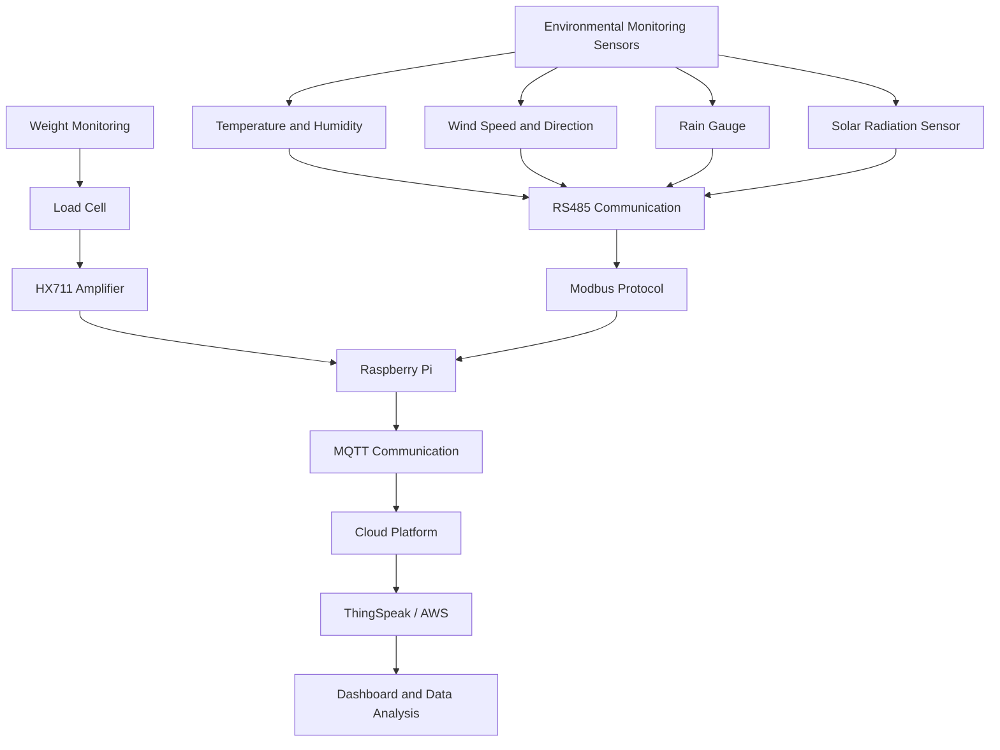
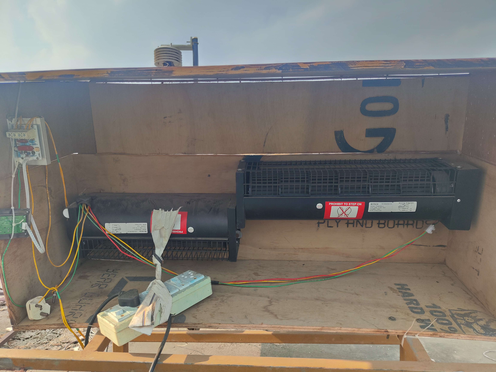
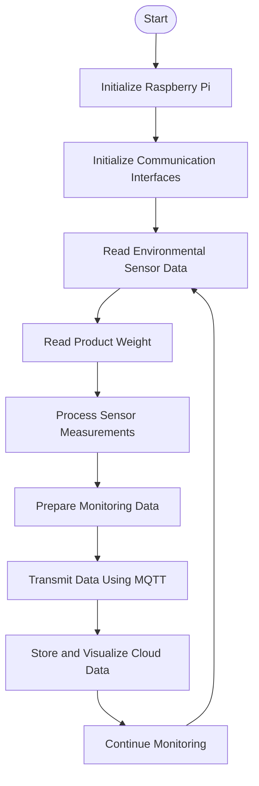
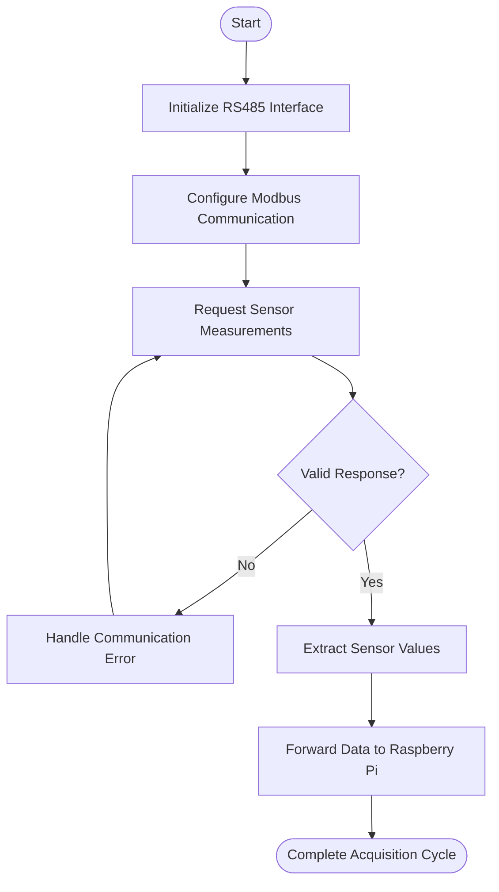
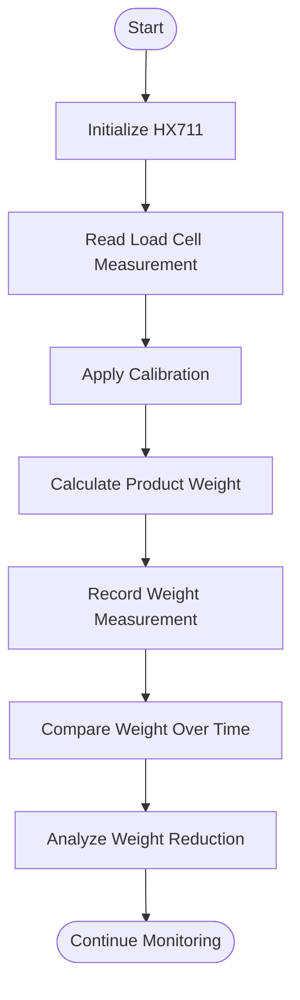
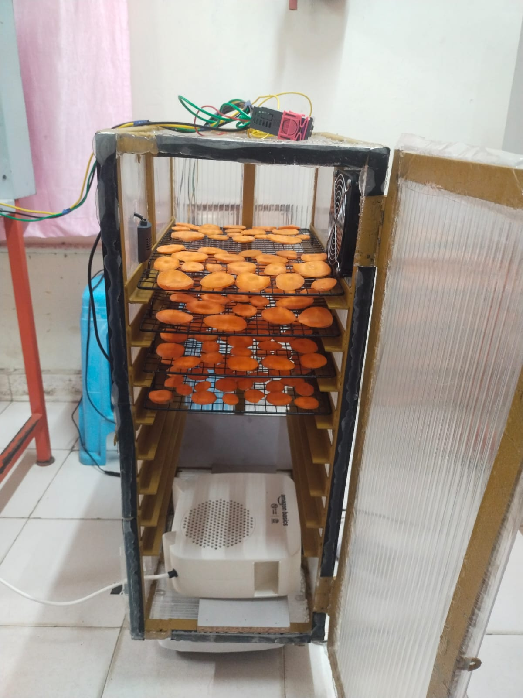
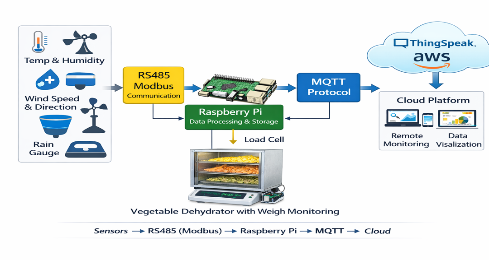
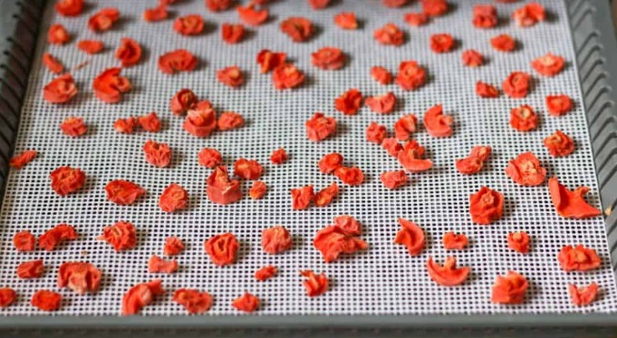

# Integration of Weight Monitoring and Micro Weather Monitoring for Indirect Solar Dehydration Using Raspberry Pi

<p align="center">
  
</p>

<h3 align="center">IoT-Based Smart Solar Dehydrator with Real-Time Weight and Environmental Monitoring</h3>

<p align="center">
  <b>Raspberry Pi | Python | Embedded Systems | IoT | MQTT | Modbus | RS485</b>
</p>

---

## 1. Project Overview

This project presents an IoT-based monitoring system for an **Indirect Solar Dehydrator**, integrating continuous product weight monitoring with micro-weather monitoring using Raspberry Pi.

The system monitors environmental parameters and product weight during the drying process. Sensor measurements are collected through an RS485 communication interface using the Modbus protocol and processed by Raspberry Pi.

The collected data is transmitted to cloud platforms using MQTT, enabling remote monitoring, visualization, data logging, and drying performance analysis.

The primary objective is to improve drying efficiency, reduce post-harvest losses, and maintain product quality through continuous monitoring and data-driven analysis.

### Key Highlights

- Real-time temperature and humidity monitoring.
- Solar radiation measurement.
- Wind speed and wind direction monitoring.
- Rainfall monitoring.
- Continuous product weight measurement using load cells.
- Raspberry Pi-based data acquisition.
- RS485 and Modbus communication.
- MQTT-based cloud data transmission.
- Remote monitoring and drying performance analysis.

---

## 2. Problem Statement

Traditional open-sun drying methods have several limitations:

- Exposure to dust, insects, and environmental contamination.
- Uneven drying and inconsistent product quality.
- Dependence on changing weather conditions.
- Lack of continuous environmental monitoring.
- Manual observation of product moisture reduction.
- Difficulty determining the appropriate drying completion point.

This project addresses these challenges through an integrated monitoring system that combines environmental measurements and weight-loss monitoring in an indirect solar dehydration setup.

---

## 3. Project Objectives

1. Monitor temperature and humidity in real time.
2. Measure solar radiation intensity.
3. Monitor wind speed and wind direction.
4. Detect rainfall and changing weather conditions.
5. Measure product weight continuously using load cells.
6. Collect sensor measurements through Raspberry Pi.
7. Transmit monitoring data to cloud platforms.
8. Enable remote visualization and data logging.
9. Analyze drying performance using environmental and weight measurements.
10. Improve drying efficiency and product quality.

---

## 4. System Architecture

The system consists of environmental monitoring sensors, a weight monitoring unit, a communication interface, a Raspberry Pi processing unit, and cloud-based monitoring.

### 4.1 Overall System Block Diagram



### 4.2 System Working Principle

1. Environmental sensors measure the surrounding micro-weather conditions.
2. The weight monitoring unit measures the weight of the drying product.
3. Sensor measurements are acquired through the corresponding communication interfaces.
4. RS485 and Modbus are used for environmental sensor communication.
5. Raspberry Pi processes and collects the acquired measurements.
6. MQTT is used to transmit monitoring data to the cloud.
7. Cloud platforms provide remote visualization and data analysis.

---

## 5. Hardware Components

### 5.1 Environmental Monitoring Unit

The environmental monitoring unit measures the weather parameters that influence the dehydration process.

| Component | Purpose |
|---|---|
| SHT31 Temperature and Humidity Sensor | Measures temperature and relative humidity |
| Wind Speed Sensor | Measures wind velocity |
| Wind Direction Sensor | Determines wind direction |
| Rain Gauge Sensor | Monitors rainfall |
| Solar Radiation Sensor | Measures solar radiation intensity |

### Environmental Monitoring Hardware

<p align="center">
  
</p>

### 5.2 Weight Monitoring Unit

The weight monitoring unit measures the reduction in product weight during dehydration.

**Components:**

- Load Cell
- HX711 Load Cell Amplifier Module

The load cell measures the product weight, while the HX711 module amplifies and converts the load-cell signal into digital measurements.

Continuous weight monitoring helps evaluate moisture removal during the drying process.

### 5.3 Processing and Communication Unit

| Component | Function |
|---|---|
| Raspberry Pi | Central processing and data acquisition |
| RS485 Module | Industrial sensor communication |
| ESP8266 | Communication validation testing |
| HX711 | Load-cell signal conditioning |

### 5.4 Power Supply Unit

The power system provides the required voltage levels for different hardware components.

**Components:**

- Multi-output power distribution board.
- XL6009 DC-DC converter.
- Individual power outputs for monitoring and control modules.

The power distribution arrangement is designed to provide suitable supply voltages to the connected hardware.

### 5.5 Drying System

The indirect solar dehydrator consists of:

- Solar air collector.
- Drying chamber.
- Drying trays.
- Forced-air blower.
- Environmental monitoring station.
- Raspberry Pi-based monitoring system.

The indirect solar arrangement heats the air through the solar collector before directing it into the drying chamber.

### Blower and Drying System

<p align="center">
  
</p>

### Overall Hardware Setup

<p align="center">
  
</p>

---

## 6. Software and Technologies

### Programming Languages

- Python
- Embedded C

### Communication Protocols

| Protocol | Application |
|---|---|
| RS485 | Physical communication interface |
| Modbus | Environmental sensor data communication |
| MQTT | Cloud data transmission |

### Cloud Platforms

- ThingSpeak
- AWS

### Development Tools

- Visual Studio Code
- Arduino IDE

### Processing Platform

- Raspberry Pi

---

## 7. System Data Acquisition Flow

The following flowchart represents the overall monitoring process.



### 7.1 Environmental Data Acquisition



### 7.2 Weight Monitoring Flow



---

## 8. Project Features

### Real-Time Environmental Monitoring

Continuous monitoring of:

- Temperature.
- Relative humidity.
- Solar radiation.
- Wind speed.
- Wind direction.
- Rainfall.

### Continuous Weight Monitoring

Load-cell measurements provide information about product weight reduction during dehydration.

### Cloud-Based Monitoring

Sensor data is transmitted to cloud platforms using MQTT for remote visualization and monitoring.

### Data Logging and Analysis

Collected measurements can be stored and analyzed to understand drying performance and environmental variations.

### Remote Monitoring

Cloud-based visualization enables monitoring without requiring continuous physical observation of the dehydrator.

---

## 9. Experimental Setup

The experimental setup uses an indirect solar dehydrator equipped with a solar air collector, drying chamber, blower, and monitoring sensors.

Carrot slices were used as the sample product for dehydration experiments.

The system records environmental parameters and product weight during the drying process to study the relationship between environmental conditions and moisture reduction.

### Overall Project Setup

<p align="center">
  
</p>

### Dehydrator Structure

<p align="center">
  
</p>

### Project Methodology

<p align="center">
  
</p>

---

## 10. Results and Discussion

### 10.1 Key Observations

The following observations were recorded during the dehydration experiments:

- Continuous reduction in product weight indicated moisture removal.
- Higher temperatures increased drying rates.
- Higher relative humidity reduced drying efficiency.
- Airflow through the drying chamber supported more uniform drying.
- Weight monitoring provided information about the drying progress.

### 10.2 Experimental Results

<p align="center">
  
</p>

### 10.3 Carrot Dehydration Results

<p align="center">
  
</p>

### 10.4 Results and Discussion

<p align="center">
  
</p>

### Project Achievements

- Real-time monitoring system developed.
- Cloud-based monitoring implemented.
- More than 90,000 sensor samples collected.
- Product weight monitored using load-cell technology.
- Environmental data integrated with drying performance analysis.

---

## 11. Applications

### Agriculture and Food Processing

- Vegetable dehydration.
- Fruit dehydration.
- Agricultural product preservation.
- Grain drying.

### Food Export and Processing Industry

Potential applications include agricultural product processing for export markets such as:

- USA
- Europe
- UAE
- Saudi Arabia

### Rural and Remote Areas

- Small-scale farming communities.
- Rural food-processing facilities.
- Areas with limited storage infrastructure.
- Regions requiring decentralized agricultural preservation solutions.

---

## 12. Future Scope

The project can be further enhanced through the following developments:

1. **Automatic Drying Control:** Implement automatic control of blower operation based on environmental conditions.
2. **AI-Based Drying Prediction:** Use machine learning to predict drying time and moisture reduction.
3. **Mobile Application:** Develop an application for real-time monitoring.
4. **Standalone Solar Operation:** Integrate solar-powered energy management.
5. **Advanced Analytics:** Apply data analytics to identify optimal drying conditions.
6. **Automated Drying Completion Detection:** Develop intelligent weight-based drying completion estimation.

---

## 13. Repository Structure

```text
Smart-Solar-Dehydrator-RPi/
│
├── README.md
│
├── images/
│   ├── Dehydrator.jpeg
│   ├── Methodology.png
│   ├── Project Setup.jpeg
│   ├── Results and Discussion.png
│   ├── Results.jpeg
│   └── carrot Results.jpeg
│
├── hardware/
│   ├── Blower.jpg
│   ├── Hardware setup.jpg
│   ├── Project Setup.jpeg
│   └── Temp and Hum sensors.jpg
│
├── software/
│
├── docs/
│
├── data/
│
├── reports/
│
└── presentations/
```

*The software, documentation, data, reports, and presentations directories are shown as the intended repository organization.*

---

## 14. Team Members

| Name |
|---|
| M. Narendra |
| B. Hemanth Kumar |
| I. Dilip Kumar |
| P. Kamakshi Prasad |

### Project Guide

**Dr. P. Murugapandiyan**

Department of Electronics and Communication Engineering

Anil Neerukonda Institute of Technology and Sciences (ANITS)

---

## 15. Conclusion

The project integrates environmental monitoring and product weight measurement into an indirect solar dehydration system using Raspberry Pi.

By combining environmental sensors, load-cell-based weight measurement, RS485 communication, Modbus, and MQTT-based cloud connectivity, the system provides a platform for continuous monitoring and analysis of the dehydration process.

The integration of micro-weather measurements and product weight monitoring helps understand drying behavior and supports improved monitoring of agricultural dehydration processes.

---

## 16. License

This project is developed for academic and research purposes.

---

<p align="center">
  <b>SMART SOLAR DEHYDRATOR</b><br>
  IoT-Based Environmental and Weight Monitoring for Indirect Solar Dehydration<br><br>
  Developed by the ECE Project Team<br>
  Anil Neerukonda Institute of Technology and Sciences (ANITS)
</p>
